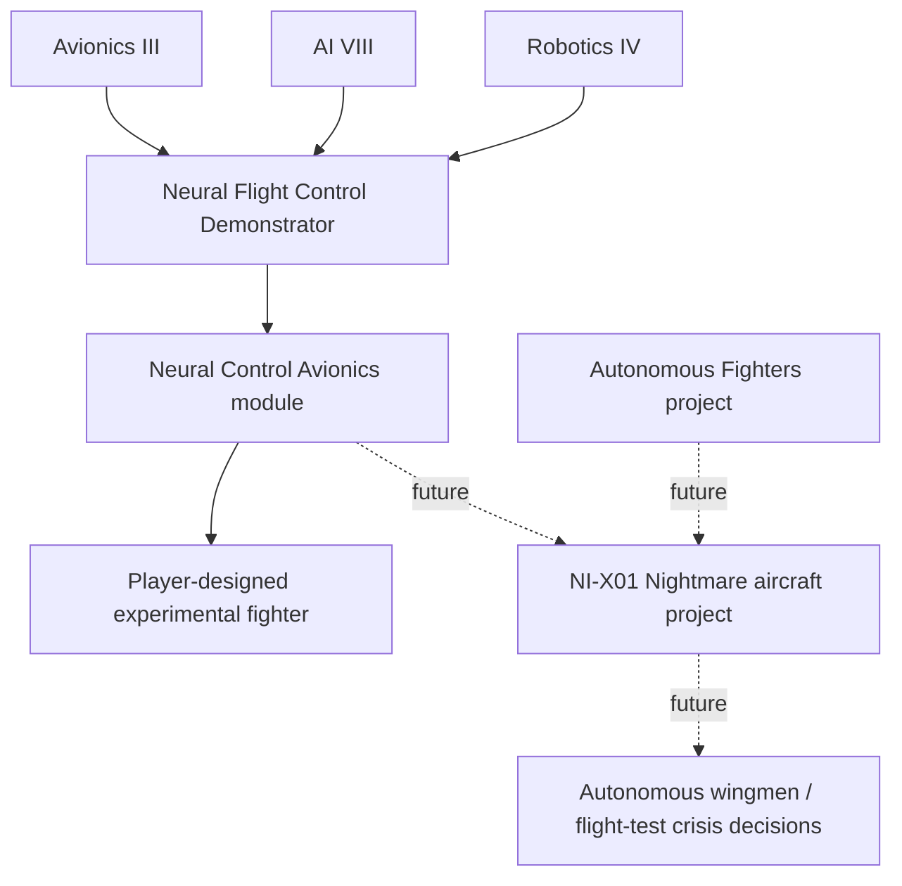

# Neural Interface Initiative
## Millennium Dawn OEM gameplay and implementation design

| Field | Value |
| --- | --- |
| Document | Neural Interface Initiative (NII) |
| Version | v0.2, implementation contract |
| Date | 2026-10-15 |
| Target | `JasonBreen/Millennium-Dawn-OEM` |
| Working branch | `oem/neural-interfaces-prototype` |
| Status | Source implementation drafted; native gameplay acceptance pending |
| Priority | Vertical slice first; avoid adding a parallel game system |

The first release adds a native neural flight-control project, a priced manned-fighter avionics module, five-focus national branches for eight powers, and their AI research and procurement route. Native designer, production, deployment, focus-layout, and save/reload acceptance is still pending; the feature stays in draft until those results are recorded.

## Current implementation contract

This contract reflects the October 15 decisions in [issue #536](https://github.com/JasonBreen/Millennium-Dawn-OEM/issues/536) and supersedes the initial proposal below.

| Component | Implemented contract |
| --- | --- |
| Startup selector | `rule_oem_neural_aviation`, default `DISABLED`, displayed as Experimental Neural Aviation |
| Native project | `oem_sp_neural_flight_control`, air specialization, avionics/aeronautics tag, long prototype time, large complexity |
| Requirements | By Blood Alone, completed `sp_aircraft_project`, `avionics_3`, `computing_5`, and 2030 `artificial_intelligence_9` |
| Research costs | Three air breakthroughs and five microchips through native project resource costs |
| Completion | Enables only `oem_avionics_neural_assisted_1`; focuses and events do not grant that module |
| Aircraft path | Existing fighter/interceptor designs, normal production, and ordinary air-wing deployment |

Neural avionics explicitly retain the fourth-generation manned package's defense, targeting, night, ground-attack, bombing, and manpower fields. The module costs 37 IC, 11 weight, five microchips, and four design XP; it adds -0.08 reliability and uses agility 0.24, air attack 0.24, and air superiority 0.19 modifier coefficients. These coefficients describe module modifiers, not guaranteed final-aircraft percentage changes. Existing conventional aircraft do not receive these stats automatically.

Designer restrictions exclude other mission types, light/heavy fully autonomous flight control, and the Arsenal Bird mothership. The repeated-module count limits follow installed game documentation but still need native designer proof. The copied conversion field is unverified; this release makes no retrofit claim.

USA, CHI, SOV, ENG, FRA, GER, JAP, and RAJ each receive the same five-step mechanical sequence with national names and descriptions:

1. Charter: one 20% AI9 research bonus and 10 air XP.
2. Control laboratory: one air breakthrough after AI8.
3. Manned testbed: 10% native project progress after the project prerequisites and an air facility.
4. Flight qualification: another 10% progress, with five air XP if research is already complete.
5. Procurement: 25 air XP after native project completion.

The testbed also gives five air XP if research is already complete. All branches require the selector and By Blood Alone. Other qualifying countries can use the global project without these national branches.

The eight AI powers receive prerequisite research preferences, focus-plan support, project selection weight, and a shared neural interceptor template. The template follows organically unlocked gen4/gen5/gen6 medium fighter hulls and uses conventional module fallbacks where later components are missing. Its preference retires at `avionics_4` so the prototype does not displace newer conventional avionics. Existing interceptor ratios, resource production, and plane caps control procurement. Actual facility/scientist staffing, focus selection, designs, producing lines, wings, chip shortages, and cap behavior remain native acceptance gates.

Ace Combat supplies broader technology and program references than COFFIN alone. The first slice uses original OEM names and restrained Belkan references; later work retains the earlier Nightmare concept, COFFIN integration, Flight 017, separately researched weapons, and priced manned-unmanned teaming. Reference sources include the [official Ace Combat chronology](https://acecombat.jp/en/chronicle/details/) and [Bandai Namco's manned and unmanned aircraft overview](https://www.bandainamcoent.com/news/ace-combat-7-skies-unknown-season-pass-revealed).

The existing `sp_arsenal_bird` already unlocks `mothership_equipment_1`, fighter/bomber/anti-ship drone-swarm modules, a missile bay, and arsenal autonomous control. It requires nuclear engines plus autonomous fighters and bombers. That implementation remains adjacent content; this slice adds no mothership or drone reward. No new 3D model is needed. A later custom airframe can reuse or port a suitable existing model after its source and usable asset terms are checked.

## Archived v0.1 design proposal

The remaining sections preserve the October 14 proposal for future design context. Their earlier identifiers, prerequisites, costs, and milestone allocation are historical; use the current implementation contract above for this release.

## 1. Feature concept

Neural interfaces are an advanced, research-intensive family of human-machine technologies. They progress from pilot assistance and interpretation of neural signals to speculative high-bandwidth control of aircraft and cooperating drones.

**Player fantasy:** direct a national program that pushes beyond conventional avionics, takes costly technical risks, and eventually produces a customized Nightmare-class experimental fighter.

**Design pillars**

1. **Earned breakthroughs.** A combat-capable system requires a modern AI stack, robotics, avionics, a research facility and a completed special project.
2. **Meaningful engineering tradeoffs.** More responsive aircraft cost more, require more advanced materials, and suffer prototype reliability issues.
3. **Country-agnostic first.** Any capable state may attempt the program; no exclusive USA/Belka country tag gate.
4. **Native MD integration.** Existing technology and special-project frameworks come first; new scripted GUIs or a second designer are not justified for v0.1.
5. **Expandable but detachable.** Neural aviation is the first application. Ground systems, military medicine and long-range autonomous command can be added as separate branches later.
6. **Plausible near-term research, explicitly speculative endgame.** Current BCIs and autonomous aircraft research provide inspiration; direct neural fighter control is an alternate-future extrapolation, not an established 2026 capability.

## 2. Deliverable scope

### v0.1 OEM vertical slice — required

- One special project: **Neural Flight Control Demonstrator** (`sp_ni_neural_flight_control`).
- Three existing technology prerequisites: `avionics_3`, `artificial_intelligence_8` and `robotics_4`.
- Existing aircraft research specialization (`specialization_air`) and project tag (`sp_tag_avionics_aeronautics`).
- One project completion unlock: **Neural Control Avionics** (`ni_neural_control_avionics`).
- The module uses the existing `plane_avionics` category and aircraft `avionics_type_slot`; it does **not** add a slot.
- Standard air prototype rewards for the initial research play loop.
- English localization for project name, description, module and player-facing effects.
- Clear in-game lock conditions and a manual test matrix.
- Existing icon/placeholder assets, only after their sprite keys are verified. No mandatory new art in the first implementation.

### v0.1 non-goals

No new technology tab, no custom GUI, no neural-overload minigame, no custom airframe, no autonomous squadron spawning, no neural augmentations for divisions, no new economy-wide production resource, no country-specific focus tree, and no mandatory AI Race mode. Do not build the entire future feature up front.

### v0.2/v0.3 follow-on content

- **v0.2:** experimental aircraft program, incident choices and a player-named NI-X01 prototype variant, preferably leveraging existing designer capabilities.
- **v0.3:** loyal-wingman integration, intelligent airpower procurement, potential strategic responses, AI adoption, and balance/economy integration.
- **Later:** optional military neurotechnology branch for medicine, ground robotics, and communications. Consider a conventional versus speculative game-rule split only once content exists to justify it.

## 3. Existing OEM systems and exact integration points

The following identifiers were checked against the connected OEM repository's `main` branch on 2026-10-14:

| Existing item | Verified details | Role |
| --- | --- | --- |
| `common/technologies/BBA_aircraft.txt` | `avionics_3` has start year 2020; `avionics_4` has start year 2040 | The aircraft-avionics gate; prototype can occur before the 2040 tech |
| `common/technologies/engineering.txt` | `artificial_intelligence_8` and `robotics_4` both have start year 2020 | Computing/autonomous-system requirements |
| `common/special_projects/projects/air_projects.txt` | `sp_fully_autonomous_computers_framework` and `sp_fully_autonomous_fighters` already exist | Later autonomous-wingman synergy; do not rewrite |
| `common/special_projects/project_tags/tags.txt` | `sp_tag_avionics_aeronautics` and `sp_tag_pilotless_vehicles` exist | Use the existing thematic tags |
| `common/units/equipment/MD_plane_airframes.txt` | Aircraft include required `avionics_type_slot` accepting `plane_avionics` | Existing compatible module slot |
| `common/units/equipment/modules/MD_plane_modules.txt` | `avionics_manned_4` uses `plane_avionics`; `fully_autonomous_computer_system_light` uses `plane_special_design` | Balance comparator and later wingman building block |
| `common/special_projects/prototype_rewards/generic_air_prototype_rewards.txt` | Existing progress, scientist and failure rewards | Avoid writing a custom event framework for the first slice |
| `common/decisions/MD_ai_race_decisions.txt` | `ai_race_full_mode` and `ai_race_stage` are already used | Optional future accelerator, **not** a hard prerequisite |

**Important:** Researching the three prerequisite techs is necessary but not sufficient. The player must also complete the new special project to unlock the module. This means an ordinary advanced avionics unlock does not unintentionally grant neural interfaces to every country.

**BBA handling:** The first module uses the By Blood Alone plane designer. Mirror existing `allowed = { has_dlc = "By Blood Alone" }` patterns. A non-BBA gameplay fallback is not part of the first slice; confirm the project is hidden or non-blocking without that DLC.

## 4. Progression and campaign fantasy



### P1: Neural Flight Control Demonstrator

**Description:** A multidisciplinary air research program explores pilot-command decoding, AI-assisted aircraft controls, neural signal filtering and high-speed man-machine coordination. Success authorizes limited experimental combat deployment.

- **Available:** A nation with `avionics_3`, `artificial_intelligence_8` and `robotics_4`, with the relevant DLC.
- **Research framework:** `specialization_air` with normal facility/scientist and breakthrough mechanics.
- **Indicative cost:** 3 air breakthrough points, `sp_time.prototype.long`, `sp_complexity.large`, and a resource drain of aluminium 5 / tungsten 2 per existing project syntax.
- **Reward:** Unlock `ni_neural_control_avionics`, not a country-wide combat bonus.
- **Testing:** Use existing standard air prototype reward entries, including a normal failure entry. Resist custom reward complexity until the basic unlock works.
- **AI:** Set project AI weight to zero for the first testing pass. Add country-specific adoption only when AI equipment designs and production plans are prepared.

### P2: Project NIGHTMARE (future)

Once P1 works, introduce `sp_ni_nightmare_aircraft` as an especially expensive special project. It requires P1 completion, an appropriate late-game airframe, higher AI tech and, for the autonomous-wingman option, completion of `sp_fully_autonomous_fighters`. The airframe name is a **working OEM codename**; the player should be able to rename the design.

Suggested program choices:

| Choice | Gameplay outcome | Tradeoff |
| --- | --- | --- |
| Conservative neural governors | Higher prototype reliability | Less agility and testing progress |
| Adaptive neural control | Strongest balanced technology | Increased development time and manufacturing expense |
| Unrestricted neural response | Maximum experimental maneuverability | Lower reliability and risk of flight-test setbacks |
| Neural-drone command integration | Improved aircraft/UCAV coordination | Requires separate autonomous-project research and greater resources |

A completed project should **unlock a capability**, not magically grant permanent bonuses to every pre-existing fighter.

### P3: Operational aircraft and wingmen (future)

Prefer unlocking a custom loadout/variant in the existing designer before introducing a whole new airframe archetype. An actual NI-X01 airframe should only be added after checking equipment type, AI role, production, unit stats, graphics and save behavior.

Do **not** claim vanilla HOI4 enforces a hard global cap of 4–6 aircraft. Treat extreme cost and limited industrial capacity as the first scarcity mechanisms; investigate hard caps separately before promising them.

## 5. Balance proposal: v0.1 module

The first module competes with `avionics_manned_4` rather than layering unrestricted buffs onto a completed aircraft. These are **provisional script coefficients**, not tested final values:

| Parameter | OEM comparator: `avionics_manned_4` | Proposed `ni_neural_control_avionics` |
| --- | ---: | ---: |
| `air_agility` within `multiply_stats` | 0.18 | 0.24 |
| `air_attack` within `multiply_stats` | 0.20 | 0.24 |
| `air_superiority` within `multiply_stats` | 0.15 | 0.19 |
| `air_defence` within `add_stats` | 36 | 36 |
| `build_cost_ic` within `add_stats` | 23 | 37 |
| `microchips` in module resource cost | 3 | 5 |
| `weight` | 9 | 11 |
| `reliability` within `add_stats` | no extra penalty | -0.08 |

Keep other offensive modifiers at the comparator's values for the first pass. Neural flight control should improve dogfighting responsiveness, **not** automatically become the strongest bombing, CAS, anti-ship, strategic bombing and night-combat module.

**Balance acceptance:** Compare a normal advanced fighter with one using neural avionics on the *same airframe and other modules*. Capture total production cost, total reliability and air combat stats. The neural plane should be clearly more capable but significantly more expensive, and the reliability downside should be visible in the designer.

For the later full Nightmare airframe, target an initial total aircraft manufacturing cost on the order of 2.5–4× a peer multirole fighter, subject to actual OEM economics and designer testing. This is a target, not a fixed scripted cost or aircraft cap.

## 6. Proposed implementation sketch (not yet committed as gameplay code)

The code below follows patterns observed in the OEM air special-project files. Confirm engine parsing, actual module unlock, syntax and localizations in game. This is **a sketch, not a verified drop-in patch**.

```pdx
sp_ni_neural_flight_control = {
	allowed = { has_dlc = "By Blood Alone" }
	specialization = specialization_air
	project_tags = sp_tag_avionics_aeronautics

	breakthrough_cost = {
		specialization_air = 3
	}

	prototype_time = sp_time.prototype.long
	complexity = sp_complexity.large

	resource_cost = {
		resources = {
			aluminium = 5
			tungsten = 2
		}
	}

	available = {
		FROM = {
			has_tech = avionics_3
			has_tech = artificial_intelligence_8
			has_tech = robotics_4
		}
	}

	project_output = {
		enable_equipment_modules = {
			ni_neural_control_avionics
		}
	}

	generic_prototype_rewards = {
		sp_air_generic_reward_scientist_xp_1
		sp_air_generic_reward_major_progress_1
		sp_air_generic_reward_test_failure_1
	}

	ai_will_do = { base = 0 }
}
```

The actual module belongs in the existing `equipment_modules` block in `common/units/equipment/modules/MD_plane_modules.txt`. Use `category = plane_avionics` and the comparator `avionics_manned_4` as the parent/reference. Only test the module after adding correct localization and ensuring it remains gated by the special-project unlock. Reuse the existing required `avionics_type_slot` rather than editing every airframe.

## 7. Later prototype incidents and special rewards

Do not make a bespoke crash/random-event system for v0.1. After the basic project completes reliably, write one high-value test-failure event or unique prototype reward:

**"Flight Test 017: Neural Saturation"** — An experimental aircraft achieves unanticipated control responsiveness, but its neurofeedback channel destabilizes under sustained maneuvers.

Two main responses:
- **Ground the fleet and fit limiters:** engineering delay, slightly reduced peak performance, improved reliability and possible scientist experience.
- **Authorize envelope expansion:** accelerate the program and unlock maximum response tuning with lasting prototype reliability risk.

Store only state that cannot be queried from completed projects, equipment modules or applied ideas. An explicit program-safety choice may require a country flag or variable because it represents historical player intent.

Longer-term narrative events could include pilot qualification issues, competing contractor proposals, foreign espionage, black-budget leaks, testing controversies, and countries rushing competing systems. None belongs in P1.

## 8. AI Race integration

The neural initiative should coexist with the OEM AI Race but **must not depend on** `ai_race_full_mode = yes`; otherwise it would disappear under alternate game-rule settings.

- **P1:** Use only normal research prerequisites and the air special-project facility.
- **P2:** Allow a successful AI Race frontier stage to reduce program research time/cost through existing, verified triggers and effects.
- **P3:** Consider supply-chain disruptions, semiconductor investment advantages, rival programs, embargoes and intelligence competition.
- **Guard:** Avoid copying AI Race state or creating parallel global stage counters.

The existing `ai_race_stage` variable should be read, not duplicated. Verify exact scope and comparison syntax before implementing any accelerator.

## 9. Implementation file map

| File/path | Action | Target phase |
| --- | --- | --- |
| `design/neural-interfaces-oem-gdd.md` | This specification | P0 |
| `common/special_projects/projects/ni_neural_projects.txt` | Define demonstrator project | P1 |
| `common/units/equipment/modules/MD_plane_modules.txt` | Add one neural avionics module | P1 |
| `localisation/english/NI_neural_interfaces_l_english.yml` | English project/module/tooltips | P1 |
| `common/special_projects/prototype_rewards/ni_neural_rewards.txt` | Add unique overload/testing choices | P2 |
| `events/NI_neural_interfaces.txt` | Operational test incident and program news | P2 |
| `common/ideas/NI_neural_interfaces_ideas.txt` | Program choices if genuinely needed | P2 |
| `common/special_projects/projects/ni_neural_projects.txt` | Later NIGHTMARE project definition | P2 |
| `common/ai_equipment/generic_plane.txt` and nation plane files | Enable sane AI designs only after player prototype tests | P3 |
| `common/game_rules/00_game_rules.txt` | Optional conservative/experimental branch split | Later |

Do not create a scripted GUI unless the existing special-project presentation demonstrably fails. Do not modify `resources/`. English localization only; per `AGENTS.md`, new English .yml uses UTF-8 with BOM, while .txt script files use UTF-8 without BOM.

## 10. Implementation milestones and exit tests

### P0 — Design and repository setup
- [x] Identify OEM repository and native research/project/plane-designer architecture.
- [x] Establish feature branch and commit this design (subject to successful GitHub write).
- [ ] Confirm actual country test harness, active DLC and local mod installation.
- [ ] Record baseline plane stats for a same-era module comparison.

### P1 — Minimum playable vertical slice
- [ ] Define demonstrator project with genuine prerequisite tech gates.
- [ ] Add neural avionics module and its special-project-only unlock.
- [ ] Add English localization; use a verified existing project icon or placeholder.
- [ ] Verify a test nation **without** prerequisite tech cannot start the project.
- [ ] Verify a qualifying nation **with** prerequisites can start, progress and complete the project.
- [ ] Verify that completion unlocks the neural module in a relevant plane designer.
- [ ] Verify that a non-completing nation cannot select the module.
- [ ] Verify cost and reliability tradeoffs on an otherwise identical aircraft design.
- [ ] Confirm no critical script errors or missing localization.
- [ ] Confirm no unexpected dependence on AI Race full mode.
- [ ] Confirm absence of BBA does not create broken access/UI.

**P1 definition of done:** in a regular game, a qualifying player can finish research, open the aircraft designer, fit neural avionics, and produce the resulting variant, while another country without the project cannot. This must work before any X-01 aircraft assets are added.

### P2 — Nightmare prototype
- [ ] Unlock a distinct experimental aircraft program.
- [ ] Test whether an existing advanced airframe + unlocked modules is sufficient.
- [ ] If not, design a new airframe and complete all required equipment/AI/localization paths.
- [ ] Add one meaningful testing incident with an enduring mechanical consequence.
- [ ] Produce an expensive operational named NI-X01 design.
- [ ] Compare against contemporary aircraft and avoid unbounded stats.

### P3 — Strategic content
- [ ] Check autonomous-project prerequisites and wingman implementation route.
- [ ] Add AI nation research priorities, designed equipment roles and production.
- [ ] Add limited international response content.
- [ ] Add economy/AI Race accelerators if measurable and justified.
- [ ] Run a short 2025–2040 country comparison playtest.

### Validation procedure

Use the OEM `AGENTS.md` and relevant reference guides. Verify identifiers and effects before use. As directed by repository rules, do not run proactive global CI, all-files hooks or broad unrelated refactors. Content validation runs at PR time. For local scripts, use narrow checks and a manual in-game smoke test. Any PR that **changes gameplay files** must add exactly one BLUF `Changelog.txt` line under the current version in an existing category. No changelog line is needed for the design-only P0 commit.

Manual cases: USA with prerequisites; USA without one prerequisite; a non-USA qualifying major (e.g., CHI); AI Race alternate mode; no BBA; restart/cancel special project; equipment designer re-entry; normal production; reload save. Treat prototype saves as disposable when necessary per OEM instructions.

## 11. Risks and decisions to revisit

| Risk/unknown | Response |
| --- | --- |
| Near-future BCI realism | Keep P1 as AI-mediated *assisted* control. Full mind-direct flight is speculative P2+ content |
| Wrong research path | Verify `available` scope and in-game facility visibility against existing air projects |
| Stat/production imbalance | Tune module against `avionics_manned_4` on identical airframes, not isolated numbers |
| BBA DLC dependency | Explicit for P1; non-BBA branch later only if worth maintaining |
| Accidental free module access | Confirm unlock gating in game, including countries with every prerequisite tech but no project |
| AI never builds equipment | Add `common/ai_equipment` templates and role production only in P3 |
| AI Race disabled | Normal tech + project mechanics always work |
| Too many bespoke systems | No new UI, resource, facility specialization or event engine until proven necessary |
| Hard cap fantasy | Simulate rarity economically first; do not claim an unsupported production cap |
| Naming/creative assets | `NI-X01 Nightmare` is a working OEM homage, not a declaration of an existing canonical HOI4 vehicle |

## 12. Reference material

**Verified OEM sources**

- [OEM AGENTS.md](https://github.com/JasonBreen/Millennium-Dawn-OEM/blob/main/AGENTS.md)
- [Air special projects](https://github.com/JasonBreen/Millennium-Dawn-OEM/blob/main/common/special_projects/projects/air_projects.txt)
- [Aircraft modules](https://github.com/JasonBreen/Millennium-Dawn-OEM/blob/main/common/units/equipment/modules/MD_plane_modules.txt)
- [BBA aircraft techs](https://github.com/JasonBreen/Millennium-Dawn-OEM/blob/main/common/technologies/BBA_aircraft.txt)
- [Engineering techs](https://github.com/JasonBreen/Millennium-Dawn-OEM/blob/main/common/technologies/engineering.txt)
- [Existing airframes](https://github.com/JasonBreen/Millennium-Dawn-OEM/blob/main/common/units/equipment/MD_plane_airframes.txt)
- [Existing air prototype rewards](https://github.com/JasonBreen/Millennium-Dawn-OEM/blob/main/common/special_projects/prototype_rewards/generic_air_prototype_rewards.txt)
- [AI Race decisions](https://github.com/JasonBreen/Millennium-Dawn-OEM/blob/main/common/decisions/MD_ai_race_decisions.txt)

**Real-world inspiration, not validation of full neural flight control**

- [DARPA: Next-Generation Nonsurgical Neurotechnology](https://www.darpa.mil/research/programs/next-generation-nonsurgical-neurotechnology)
- [DARPA, 2026: U.S. Air Force flies AI-controlled F-16](https://www.darpa.mil/news/2026/darpa-us-air-force-fly-ai-controlled-f-16)
- [DARPA: Firefox high-bandwidth non-invasive neural sensing](https://www.darpa.mil/work-with-us/opportunities/darpa-ps-26-112)

---

**Design decision:** The next code change after this document should be exactly the P1 project, its avionics module and English localization. Everything else remains planned, not implemented.
